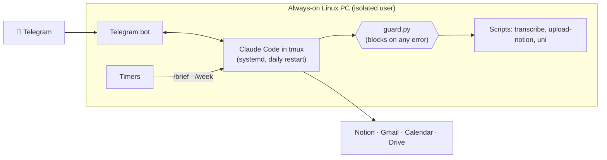

# Pelurvis

**An always-on personal assistant you talk to on Telegram.** It runs on your
own Linux box with Claude Code (or Codex), reads your Notion, Gmail and
Google Calendar, understands voice notes and photos, and sends you a morning
brief every day.

This repo is a kit: templates and a guide to build your own.

## What it can do

- 💬 **Chat from your phone** by text, voice note or photo.
- 🎙️ **Understand voice notes** with Whisper running locally on your GPU (about 1.4 s per note).
- 📥 **Capture anything** into a Notion inbox: `/capture`.
- ☀️ **Morning brief** at 06:30 with your classes, calendar, deadlines, email and inbox: `/brief`.
- ✅ **To-dos** you can add, check off and sort by urgency: `/todos`.
- 📅 **"What do I have on Thursday?"**: `/agenda`.
- 💡 **Idea backlog** with a weekly review where each idea goes, stays, freezes or gets dropped: `/idea`, `/week`.
- 👥 **Contacts** looked up from a Notion database: `/contact`.
- 🎓 **University attendance**: "I went to Physics", "how am I doing?": `/attendance`.
- 🧠 **Memory** of who you are and what you asked it to remember.

It never does anything irreversible on its own. It only drafts emails, it
can't delete, and anything risky asks for your approval with a Telegram
button.

## How it works

Each bot is split into three layers, so you can make it yours without touching code:

| Layer | Folder | What it is |
|---|---|---|
| Skeleton | `core/` | What any bot needs: service, Telegram, voice, scheduling, security. Don't touch it. |
| Muscle | `modules/` | Capabilities, one folder each. Remove the ones you don't want. |
| Skin | `skin/` | **The only part you edit**: your name, tone and IDs. |

## What you need

| | | Cost |
|---|---|---|
| A Linux PC that stays on | Ubuntu works; Tailscale to SSH in | free |
| Claude Pro or Max *(or a ChatGPT plan for Codex)* | the brain | your subscription |
| A Telegram bot | from @BotFather | free |
| Notion and Google | connected in claude.ai | included |
| A GPU *(optional)* | for local voice transcription | free |

There's no pay-per-use. The only limit is your subscription's quota.

## Getting started

1. Read **[the guide](docs/GUIDE.md)**. It walks through setup step by step for both Claude Code and Codex, and ends with a checklist to verify everything.
2. Copy a template:
   - [`templates/agent/`](templates/agent/) for **Claude Code**.
   - [`templates/agent-codex/`](templates/agent-codex/) for **Codex**. It's built to host bots for friends who never touch a terminal.
3. Fill in `skin/identity.md` and `skin/data.md`. Every `<PLACEHOLDER>` there is yours to replace.
4. Install the [systemd units](templates/systemd/) and say "hi" to your bot.

> **Heads-up:** the `university` module talks to one specific university's
> systems (a Moodle site and an academic portal). Use it as an example of a
> read-only integration, or remove it.

## Security

The agent runs unattended and reads other people's content, like emails and
web pages, so prompt injection is a real risk. It's built to contain that:

- Explicit permissions: there's an allowlist, and delete, share, send email, `sudo` and `git push` are denied.
- No free-form shell or `curl`: every external action goes through a narrow script.
- A pre-tool guard that blocks on any error. Modules can only *add* blocks.
- Credentials are loaded from a terminal, never through chat.

The reasoning behind every choice is in **[DECISIONS.md](docs/DECISIONS.md)**.

## License

[MIT](LICENSE)
